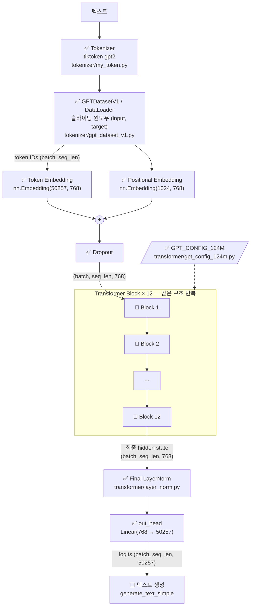
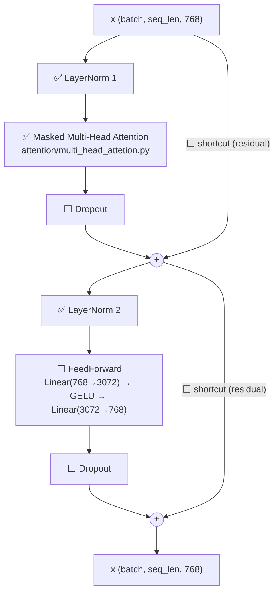
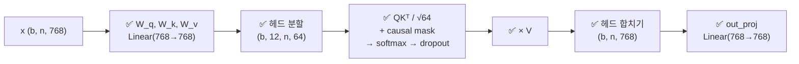
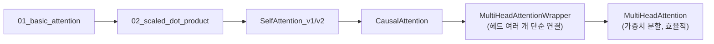

# GPT-2 구현 진행 도식

- 마지막 갱신: 2026-11-01
- 범례: ✅ 구현 완료 · 🧪 더미(자리만 있음) · ⬜ 미구현

## 1. 전체 흐름

같은 구조의 Transformer Block을 `n_layers`(12)번 **반복해서 쌓는** 구조다.
블록의 입력과 출력 shape가 `(batch, seq_len, 768)`로 같기 때문에 반복할 수 있다.

> `DummyGPTModel`(`transformer/dummy_gpt_model.py`)에 위 뼈대가 연결되어 있다. Block은 아직 입력을 그대로 반환하는 더미다.

## 2. Transformer Block 내부

> 부품(LayerNorm, MultiHeadAttention)은 만들어졌지만 `TransformerBlock` 클래스로 조립되지는 않았다.

## 3. Multi-Head Attention 내부

헤드 12개로 **나누어 병렬로 계산한 뒤 합친다**. 블록 반복과는 다른 종류의 구조다.

## 4. 학습 경로 (attention/)

## 갱신 방법
새 부품을 구현하면 해당 노드의 ⬜/🧪를 ✅로 바꾸고 파일 경로를 적는다. 맨 위의 "마지막 갱신" 날짜도 바꾼다.
