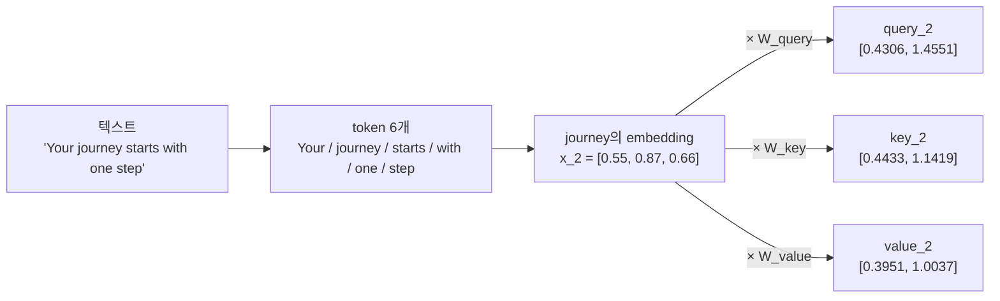
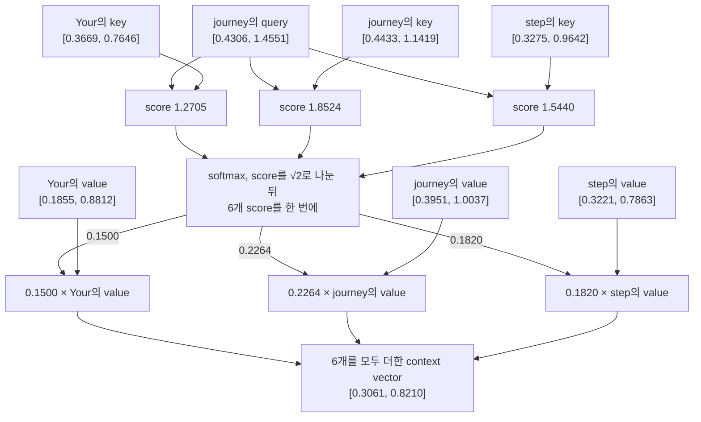

# Query / Key / Value는 어디서 나오고, 어떻게 함께 쓰이나?

- 날짜: 2026-11-01
- 관련 코드: `attention/02_scaled_dot_product_attention.py`, `attention/self_attention_v2.py`, `attention/causal_attention.py`, `attention/multi_head_attetion.py`
- 키워드: query, key, value, W_query, 행렬 곱, softmax, context vector, causal mask, multi-head, out_proj, low-rank, KV cache

## 질문

- attention은 결국 무엇을 만들려는 것인가?
- query는 어디서 나오나? token의 embedding 값을 미세조정한 것인가?
- W_query / W_key / W_value는 각자 다른 방법으로 변환하나? 세 W는 어떻게 서로 달라지나?
- W_query는 같은 행렬인데 token의 embedding에 따라 query가 달라지는 것인가? q·k·v는 "변할 수 있는 상수"인가?
- query에 따른 key, value는 무슨 의미인가? 따로 계산된다면 q·k·v는 모두 독립적인 것 아닌가?
- causal mask는 생성할 때가 아니라 학습할 때 왜 필요한가?
- 왜 768을 12개 head로 나누나? `out_proj`는 왜 있나?
- KV cache는 무엇인가?

## 짧은 답

- query(쿼리: 지금 문맥을 계산하려는 token의 벡터)는 `x_2 @ W_query`, 즉 embedding(token을 나타내는 실수 벡터)과 행렬의 곱 한 번으로 **새로 계산된 벡터**다. key, value도 같은 연산에 다른 행렬을 쓸 뿐이다.
- W는 모든 token이 공유하는 고정된 숫자(training(학습) 중에만 바뀜)이고, q·k·v는 입력이 바뀌면 함께 바뀌는 **계산 결과**다.
- 세 벡터는 계산할 때는 서로 독립이지만, 쓰일 때 "query로 점수를 매기고 → 같은 token의 key-value 쌍에서 value를 그 비율로 섞는" 역할로 묶인다.
- 그렇게 섞은 결과(context vector)는 GPT 블록에서 원래 embedding에 **더해지는 변화량**이다. embedding을 버리고 바꿔 끼우는 것이 아니다.

## 0. attention은 무엇을 만들려는가 — embedding에 더할 변화량

`nn.Embedding`(token ID로 행을 꺼내는 lookup table)은 문맥을 모른다. "mole"이 동물이든 화학 단위든 점이든 같은 벡터가 나온다. attention의 출력은 **주변 token의 정보를 모아 그 벡터에 더할 변화량**이다.

```python
# GPT-2 블록 안의 실제 쓰임 (TransformerBlock, 아직 ⬜ — 지금은 DummyTransformerBlock)
x = x + attn(norm1(x))   # attn 출력(= out_proj를 거친 context vector)이 변화량
```

| 단계 | journey의 벡터 | 문맥 |
|---|---|---|
| embedding (`inputs[1]`) | `[0.55, 0.87, 0.66]` | 없음. 어느 문장에서든 같은 값 |
| attention 출력 | 앞 token들의 value를 비율대로 섞은 값 | 이 문장의 앞 token들 |
| `x + attention 출력` | 둘의 합 | 문맥이 반영됨 → 다음 블록으로 |

> 이 저장소의 예제(`causal_attention.py` 등)는 attention 출력만 반환하고 아직 더하지 않는다. 더하는 부분은 residual connection(블록 입력을 출력에 더하는 연결)으로 `TransformerBlock`을 만들 때 구현한다.

## 1. query는 어디서 나오나 — 행렬 곱 한 번

`02_scaled_dot_product_attention.py`와 같은 설정이다. `inputs`는 3차원짜리 예시 embedding(token을 나타내는 실수 벡터) 값을 손으로 정해 둔 것이다.

```python
x_2 = inputs[1]            # "journey" = [0.55, 0.87, 0.66]
torch.manual_seed(123)
W_query = torch.rand(3, 2) # 생성 순서: query → key → value
W_key   = torch.rand(3, 2)
W_value = torch.rand(3, 2)

W_query = [[0.2961, 0.5166],
           [0.2517, 0.6886],
           [0.0740, 0.8665]]

query_2 = x_2 @ W_query    # [0.4306, 1.4551]
key_2   = x_2 @ W_key      # [0.4433, 1.1419]
value_2 = x_2 @ W_value    # [0.3951, 1.0037]
```

`@`(행렬 곱)가 실제로 하는 일: W의 **각 열이 "입력 3개를 어떤 비율로 섞을지"의 레시피**다.

| query_2 원소 | 계산 | 값 |
|---|---|---|
| 0번 | 0.55×0.2961 + 0.87×0.2517 + 0.66×0.0740 | 0.4306 |
| 1번 | 0.55×0.5166 + 0.87×0.6886 + 0.66×0.8665 | 1.4551 |

그래서 "embedding을 미세조정한 것"이 아니다. embedding의 값 3개를 섞어 **차원 수까지 다른(3개 → 2개) 새 벡터**를 만든 것이다. 참고로 fine-tuning(미세조정: 사전 학습된 모델의 가중치를 특정 작업에 맞게 추가 학습하는 것)은 ML에서 전혀 다른 뜻으로 쓰이는 용어다.



세 화살표는 서로를 참조하지 않는다. 같은 입력에 다른 행렬을 곱한 세 번의 독립 계산이다.

## 2. 같은 W_query, 다른 token → 다른 query

W_query는 token마다 따로 있지 않다. 6개 token 전부가 **같은 W_query**를 곱한다 (`queries = inputs @ W_query`).

| token | embedding | query (`@ W_query`) | key (`@ W_key`) | value (`@ W_value`) |
|---|---|---|---|---|
| Your | [0.43, 0.15, 0.89] | [0.2309, 1.0966] | [0.3669, 0.7646] | [0.1855, 0.8812] |
| journey | [0.55, 0.87, 0.66] | [0.4306, 1.4551] | [0.4433, 1.1419] | [0.3951, 1.0037] |
| starts | [0.57, 0.85, 0.64] | [0.4300, 1.4343] | [0.4361, 1.1156] | [0.3879, 0.9831] |
| with | [0.22, 0.58, 0.33] | [0.2355, 0.7990] | [0.2408, 0.6706] | [0.2393, 0.5493] |
| one | [0.77, 0.25, 0.10] | [0.2983, 0.6565] | [0.1827, 0.3292] | [0.1492, 0.3346] |
| step | [0.05, 0.80, 0.55] | [0.2568, 1.0533] | [0.3275, 0.9642] | [0.3221, 0.7863] |

| | 무엇인가 | 언제 바뀌나 |
|---|---|---|
| `W_query`, `W_key`, `W_value` | 모델에 저장된 parameter(학습으로 정해지는 숫자) | training(학습) 중 갱신될 때만. 그 외에는 상수 |
| query, key, value | `입력 @ W`의 반환값 | 입력(token, 문장)이 바뀔 때마다 새로 계산 |

즉 "변할 수 있는 상수"는 W 쪽이고(학습 때만 변함), q·k·v는 상수가 아니라 매번 계산하는 결과다.

## 3. 세 W는 무엇이 다른가

- **연산은 같다**: 셋 다 행렬 곱(`nn.Linear`도 `x @ W.T + b`, 이 저장소는 `bias=False`). "다른 방법으로 변환"하지 않는다.
- **숫자만 다르다**: 그 차이는 두 군데서 온다.

| 원인 | 설명 |
|---|---|
| 초기값 | `torch.rand`를 세 번 따로 호출 → 시작부터 다른 난수 |
| 수식 안의 역할 | W_query는 점수의 왼쪽, W_key는 점수의 오른쪽, W_value는 섞이는 재료. 그래서 loss(정답과의 차이)를 줄이는 방향인 gradient(각 가중치를 어느 쪽으로 바꿀지 나타내는 값)가 서로 다르게 나온다 |

확인: 세 W를 **똑같은 값**으로 시작해도 gradient(가중치 변경 방향)는 다르게 나온다 (임의의 목표값 `[1.0, 0.0]`에 대한 MSE loss(오차 제곱 평균), `torch.manual_seed(123)` 후 `W0 = torch.rand(3, 2)`를 셋에 복사).

| | grad 0행 | grad 1행 | grad 2행 |
|---|---|---|---|
| W_query | [0.0057, 0.0252] | [0.0078, 0.0341] | [0.0071, 0.0308] |
| W_key | [0.0016, 0.0056] | [0.0115, 0.0397] | [0.0111, 0.0381] |
| W_value | [-0.2947, 0.5079] | [-0.4212, 0.7261] | [-0.3798, 0.6546] |

갱신 방향이 다르므로 학습을 반복할수록 세 W는 서로 다른 행렬이 된다.

## 4. 쓰일 때 생기는 관계

계산 시점에는 독립이지만, attention(각 token이 다른 token을 얼마나 참고할지 계산해 정보를 섞는 연산)에서 쓰일 때 역할이 정해진다.

1. journey의 query와 **각 token의 key**를 내적 → attention score(정규화 전 관련도)
2. score를 $\sqrt{d_k}=\sqrt{2}$로 나눠 softmax(값들을 합이 1인 비율로 바꾸는 함수) → attention weight(합이 1인 비율)
3. 각 비율 × **같은 token의 value** → 전부 더하면 context vector(문맥이 반영된 결과 벡터)

| token | score (q·key) | weight | weight × value |
|---|---|---|---|
| Your | 1.2705 | 0.1500 | [0.0278, 0.1322] |
| journey | 1.8524 | 0.2264 | [0.0895, 0.2272] |
| starts | 1.8111 | 0.2199 | [0.0853, 0.2162] |
| with | 1.0795 | 0.1311 | [0.0314, 0.0720] |
| one | 0.5577 | 0.0906 | [0.0135, 0.0303] |
| step | 1.5440 | 0.1820 | [0.0586, 0.1431] |
| **합** | | 1.0000 | **context_vec_2 = [0.3061, 0.8210]** |

softmax 방향: 코드는 `torch.softmax(..., dim=-1)`로 **행마다** 합이 1이다. 행 = query를 낸 token, 열 = key를 낸 token. (3Blue1Brown 영상은 그림을 전치해서 **열마다** 합이 1이다. 내용은 같다.)

아래 도식은 token 3개(Your, journey, step)만 그렸다. 실제 합계에는 6개 token이 모두 들어간다.



### query만 바꾸면? (keys / values는 그대로)

같은 `keys`, `values`에 query만 one의 것(`[0.2983, 0.6565]`)으로 바꾼다.

| token | weight (journey의 query) | weight (one의 query) |
|---|---|---|
| Your | 0.1500 | 0.1610 |
| journey | 0.2264 | 0.1949 |
| starts | 0.2199 | 0.1923 |
| with | 0.1311 | 0.1501 |
| one | 0.0906 | 0.1265 |
| step | 0.1820 | 0.1752 |
| context vector | [0.3061, 0.8210] | [0.2927, 0.7891] |

- key와 value는 **token에 붙은 한 쌍**이다. 누가 묻든 그대로다.
- query는 "어느 쌍을 얼마나 섞을지" **비율만** 바꾼다.
- 점수는 오직 `query · key`에서만 나오므로, 학습 중 W_query와 W_key는 서로에게 맞춰지며 갱신된다(점수를 바꾸려면 둘 중 하나 또는 둘 다가 바뀌어야 함). W_value는 점수에 관여하지 않고 "섞일 내용"만 결정한다.

## 5. causal mask — 학습할 때 왜 필요한가

위 4절은 mask 없이 journey가 뒤 token(starts … step)까지 보았다. GPT는 이렇게 하면 안 된다.

이유는 학습 방식에 있다. `gpt_dataset_v1.py`의 target(정답)은 input을 한 칸 민 것이다. 한 번의 forward(입력 → 출력 계산)로 **모든 위치에서 동시에** "다음 token"을 예측한다.

| 위치 | 볼 수 있는 입력 | 맞혀야 할 정답 |
|---|---|---|
| 0 | Your | journey |
| 1 | Your journey | starts |
| 2 | Your journey starts | with |
| … | … | … |

문장 하나가 학습 예제 6개가 된다. 그런데 위치 1(journey)이 starts의 value를 섞어 가면 **정답을 보고 푸는 것**이 된다. 그래서 score의 대각선 위를 `-inf`로 채우고(`masked_fill`) softmax 하면 그 비율이 0이 된다.

| query \ key | Your | journey | starts | with | one | step |
|---|---|---|---|---|---|---|
| Your | 1.0000 | 0 | 0 | 0 | 0 | 0 |
| journey | 0.3986 | 0.6014 | 0 | 0 | 0 | 0 |
| starts | 0.2526 | 0.3791 | 0.3683 | 0 | 0 | 0 |
| step | 0.1557 | 0.2092 | 0.2048 | 0.1419 | 0.1089 | 0.1794 |

| journey의 context vector | 값 |
|---|---|
| mask 없음 (4절) | [0.3061, 0.8210] |
| causal mask | [0.3116, 0.9549] = 0.3986 × Your의 value + 0.6014 × journey의 value |

- 0이 된 자리를 빼고 다시 정규화하므로 각 행의 합은 여전히 1이다.
- 마지막 token(step)은 원래 모두를 보므로 mask가 있어도 없어도 같다([0.2990, 0.8040]).
- 이 비율표는 token 수 × token 수 크기다. GPT-2의 context length(한 번에 보는 최대 token 수) 1024면 head 하나, layer 하나에 1,048,576칸이다. 문맥이 길어질수록 비용이 제곱으로 커지는 이유다.

## 6. 왜 768을 12개 head로 나누나? `out_proj`는 왜 있나?

`multi_head_attetion.py` 기준 (GPT-2 small: `d_in = d_out = 768`, `num_heads = 12`, `head_dim = 64`).

- W_query는 나누지 않는다. 입력 768개 → 출력 768개인 `nn.Linear` 하나다.
- 결과 768개를 `view`로 **64개씩 12묶음**으로 보기만 한다. 각 묶음이 head(독립적으로 attention을 계산하는 단위) 하나의 query다. key, value도 같다.
- parameter(학습으로 정해지는 숫자) 수는 같다: 768 × 768 = 589,824 = 768 × 64 × 12.
- softmax(합이 1인 비율로 바꾸는 함수)를 **head마다 따로** 하므로, head마다 다른 token에 비율을 몰아줄 수 있다. head가 1개라면 비율 분포도 1개뿐이다.
- 12개 head의 context vector(결과 벡터)를 다시 이어 붙여 768개로 만들고, `out_proj`(head 결과들을 섞어 주는 마지막 Linear)가 섞는다.

작은 확인 (`d_out = 4`, head 2개 × 2차원, `torch.manual_seed(123)` 후 `W_query = torch.rand(3, 4)`, `W_key = torch.rand(3, 4)`, mask 없음). journey의 query `[0.3487, 1.5174, 0.4653, 0.9214]`를 둘로 나눈다.

| | head 0 (query `[0.3487, 1.5174]`) | head 1 (query `[0.4653, 0.9214]`) |
|---|---|---|
| Your | 0.1437 | 0.1719 |
| journey | 0.2353 | 0.2205 |
| starts | 0.2282 | 0.2159 |
| with | 0.1264 | 0.1256 |
| one | 0.0872 | 0.1052 |
| step | 0.1792 | 0.1609 |

무작위 초기값이라 차이가 작다. 학습을 거치면 head마다 다른 관계에 집중하도록 갈라진다는 것이 일반적인 설명이지만, 이 저장소에서는 아직 학습을 하지 않아 직접 확인하지 못했다.

### value는 64개로 줄였다가 out_proj로 768개로 되돌린다

0절에서 attention 출력은 embedding(768개)에 **더할** 값이라고 했다. 그런데 head 하나의 value는 64개뿐이다. 그 차이를 `out_proj`가 메운다.

| 단계 | head 하나 기준 | 영상의 이름 |
|---|---|---|
| `W_value`의 64열 | 768개 → 64개로 줄임 | value_down |
| `out_proj`의 64행 | 64개 → 768개로 되돌림 | value_up (12 head 것을 이어 붙인 것이 output matrix) |

768 → 768을 바로 하는 행렬(768 × 768)을 head마다 두면 head당 589,824개가 필요하다. 64개를 거쳐 가면 head당 768×64 + 64×768 = 98,304개다. 이렇게 중간을 좁힌 변환을 low-rank(낮은 계수: 중간 차원이 작아 표현 가능한 변환이 제한된) 변환이라 한다.

`MultiHeadAttention(768, 768, 1024, 0.0, 12)`의 실제 parameter 수:

| 이름 | 개수 |
|---|---|
| `W_query.weight` | 589,824 |
| `W_key.weight` | 589,824 |
| `W_value.weight` | 589,824 |
| `out_proj.weight` + `out_proj.bias` | 589,824 + 768 |
| **블록 하나** | **2,360,064** |
| × 12 layer | 28,320,768 (124M 중 약 23%) |

## 7. KV cache

KV cache(생성 중 이전 token들의 key·value를 저장해 두고 재사용하는 기법)는 텍스트를 한 token씩 만들어 갈 때 쓴다. 이 저장소에는 아직 구현이 없고, 아래는 같은 장난감 데이터로 검증한 것이다.

전제: GPT는 causal mask(미래 token을 보지 못하게 가리는 장치, `causal_attention.py`)를 쓴다. 그래서 7번째 token이 뒤에 붙어도 **앞 6개 token의 결과는 변하지 않는다.**

7번째 token embedding을 임의로 `x_7 = [0.30, 0.60, 0.20]`이라 하자.

```python
# 새 token 하나만 계산
q_7 = x_7 @ W_query   # [0.2546, 0.7414]
k_7 = x_7 @ W_key     # [0.2145, 0.6040]
v_7 = x_7 @ W_value   # [0.2363, 0.4655]

# 캐시된 keys/values(6개, 2절 표)에 새 것만 이어 붙임
K_cache = torch.cat([keys,   k_7[None]])
V_cache = torch.cat([values, v_7[None]])
w_7 = torch.softmax(q_7 @ K_cache.T / 2**0.5, dim=-1)
# [0.1399, 0.1728, 0.1702, 0.1301, 0.1077, 0.1542, 0.1251]
ctx_7 = w_7 @ V_cache  # [0.2867, 0.7510]
```

| 방법 | 7번째 token의 context vector |
|---|---|
| 7개 token 전체를 causal attention으로 다시 계산 | [0.2867, 0.7510] |
| KV cache (새 token의 q·k·v만 계산) | [0.2867, 0.7510] |

`torch.allclose` → `True`, 최대 차이 0.0. 전체 재계산 때 앞 6개 token의 결과도 6개만 계산했을 때와 동일했다(`True`).

| 질문 | 답 |
|---|---|
| 왜 재사용해도 같나 | key·value는 `그 token의 embedding @ W`라 뒤에 무엇이 오든 그대로다. causal mask 때문에 앞 token의 결과도 그대로다 |
| mask가 없다면 | 앞 token의 결과가 바뀐다. 예: journey의 context vector가 6개일 때 [0.3061, 0.8210] → 7개일 때 [0.2985, 0.7825] |
| query는 왜 캐시 안 하나 | 과거 token의 query는 과거 token의 결과를 낼 때만 필요했고, 그 결과는 이미 나왔다. 새 결과에는 새 token의 query 하나만 필요하다 |
| 비용 | 메모리. GPT-2 small 기준 token 하나당 key 768개 + value 768개 × 12 layer = 18,432개 숫자. 1024 token이면 18,874,368개, float32(4바이트)로 75,497,472바이트 = 72 MiB (sequence 하나 기준) |

## 더 알아볼 것

- 왜 $\sqrt{d_k}$로 나누나 — softmax(합이 1인 비율로 바꾸는 함수)가 한쪽으로 쏠리는 문제
- causal mask와 dropout이 attention weight에 적용되는 순서 (`causal_attention.py`)
- residual connection과 `TransformerBlock` 조립 — 0절의 `x + attn(...)`을 실제로 구현할 차례
- 구현 진행 도식: [../architecture.md](../architecture.md)
- 용어집: [../glossary.md](../glossary.md)

## 출처

- [3Blue1Brown — Attention in transformers, step-by-step (Deep Learning Chapter 6)](https://www.youtube.com/watch?v=eMlx5fFNoYc) / [텍스트판](https://www.3blue1brown.com/lessons/attention)
